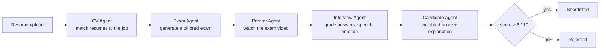
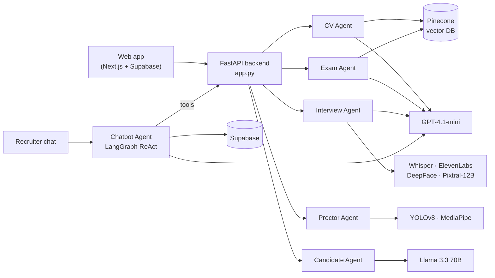

# Pantheon: Agentic AI Recruitment Platform

Pantheon automates the technical hiring funnel with **AI agents**. They screen resumes, generate a tailored exam, proctor it on video, analyse the interview and produce a final **explainable** hire/reject recommendation. A conversational recruiter assistant ties these steps together.

> Graduation project, Nile University, 2024–2025. This repository holds the FastAPI agents backend.
>
> 🎬 [Watch the demo video](https://nileuniversity-my.sharepoint.com/:v:/g/personal/s_aboalyazeed2141_nu_edu_eg/EdV6ruQeebNIgy6Ibr9lPn4Bo98JCHLa_MxmgGxEKWjAQg?nav=eyJyZWZlcnJhbEluZm8iOnsicmVmZXJyYWxBcHAiOiJPbmVEcml2ZUZvckJ1c2luZXNzIiwicmVmZXJyYWxBcHBQbGF0Zm9ybSI6IldlYiIsInJlZmVycmFsTW9kZSI6InZpZXciLCJyZWZlcnJhbFZpZXciOiJNeUZpbGVzTGlua0NvcHkifX0&e=x6X2hd)

**Stack:** Python · FastAPI · LangChain / LangGraph · OpenAI GPT-4.1-mini · Pinecone · Whisper · ElevenLabs · YOLOv8 · MediaPipe · DeepFace · Mistral Pixtral · Llama 3.3 70B · Supabase

---

## The problem

Screening technical candidates is slow and inconsistent. Recruiters read hundreds of resumes and write a new exam for every role. Online exams are easy to cheat on, and interview feedback is subjective. Pantheon gives each step to a specialised agent and combines their outputs into one transparent score that a recruiter can audit.

## How a candidate moves through Pantheon



## Architecture



## The agents

| Agent | What it does | How it works |
|---|---|---|
| **CV Agent** | Picks the best resume for a job and drafts job descriptions | Resumes are stored in a Pinecone index with built-in embeddings. A job description retrieves the top 3 by semantic similarity. GPT-4.1-mini picks one, explains why, and extracts the candidate's name and email. The Pinecone similarity score is returned as the confidence. |
| **Exam Agent** | Builds an exam tailored to the job | A question bank (4 types × 3 difficulties × 10 domains) was generated offline with GPT-4.1-mini and indexed in Pinecone. For each request the LLM reads the job description and infers metadata filters (type, difficulty, domain) plus 6 search queries. Pinecone runs filtered semantic search, and duplicates are removed. This is retrieval-augmented generation driven by an agent. |
| **Interview Agent** | Runs and analyses the interview | ElevenLabs reads the questions aloud and Whisper transcribes the answers. GPT-4.1-mini grades each answer against a golden answer (*Correct / Partially correct / Incorrect*, with reasoning). The video is also analysed: DeepFace measures the emotion distribution across frames, an LLM analyses sentiment in the transcript, and Pixtral-12B writes a behavioural summary. These are merged into one report. |
| **Proctor Agent** | Flags cheating in exam videos | Samples one frame every 2 s. YOLOv8 counts people and detects phones, laptops and screens. It reports phone frames, frames with more than one person, and changes in the number of people. |
| **Candidate Agent** | Makes the final, explainable decision | A weighted formula produces the score and decision (below). Llama 3.3 70B writes a narrative assessment. |
| **Chatbot Agent** | Recruiter assistant | A LangGraph ReAct agent with tools to create jobs, generate and save exams, and select the best candidate. It calls the other agents and Supabase on the recruiter's behalf. |

## Explainable scoring

The final decision comes from a **simple formula, not from the LLM**. A recruiter can trace every candidate's result back to the inputs. The LLM only *explains* the result and never changes it.

Each stage is turned into a 0–1 score where higher is better:

| Component | Input | Converted to 0–1 by | Weight |
|---|---|---|---|
| Resume relevance | 0–10 | ÷ 10 | 0.1 → **14%** |
| Quiz | quiz accuracy (0–1) | as is | 0.1 → **14%** |
| Proctoring | share of suspicious activity (0–1) | 1 − value | 0.1 → **14%** |
| Interview | gaze stability, expression consistency, technical depth | average | 0.4 → **57%** |

```
score    = 10 × Σ (weightᵢ × componentᵢ) / Σ weightᵢ        (0–10)
decision = "Shortlisted" if score ≥ 6.0 else "Rejected"
```

**Worked example:** resume 8/10, quiz 0.9, suspicious activity 0.1, interview (0.7, 0.8, 0.6)
→ components 0.8, 0.9, 0.9, 0.7 → **score 7.71 → Shortlisted**.

The response contains the component scores, the effective weights, a confidence level (*high* when the score is more than 1 point away from the threshold), and risk flags such as "Low proctoring compliance". The rules are pinned down by unit tests in [`candidate_agent/test_scoring.py`](candidate_agent/test_scoring.py).

## API

All routes are mounted in `app.py`. Interactive docs are at `http://localhost:8000/docs`.

| Endpoint | Input | Purpose |
|---|---|---|
| `POST /cv-agent/upload-resume_to_pinecone/` | form: `file` (PDF), `id_key` | Index a resume |
| `POST /cv-agent/choose_best_resume/` | `{job_description}` | Best resume, reason, confidence |
| `POST /cv-agent/generate_job_details/` | `{job_title, department, employment_type, experience_level}` | Draft a job description |
| `POST /exam-generation-agent/generate-questions` | `{job_description, num_questions}` | Questions, golden answers, types, difficulties, domains |
| `POST /interview-agent/text-to-speech` | `{text}` | Base64 audio of a question |
| `POST /interview-agent/transcribe-audio` | form: `file` | Whisper transcription |
| `POST /interview-agent/evaluate-exam` | `{question_list, golden_answer_list, answer_list}` | Per-answer verdicts, summary, grade % |
| `POST /interview-agent/emotional-analysis` | form: `file` (video) | Emotion and stress summary |
| `POST /interview-agent/interview-analysis` | form: `file` (video) | Full interview report (speech + sentiment + emotion) |
| `POST /proctor-agent/check-cheating/` | form: `file` (video), `candidate_name` | Phone / extra-person detections |
| `POST /candidate-agent/evaluate_candidate/` | scores from the stages above | Final score, decision, weights, LLM explanation |

Example of the final decision:

```bash
curl -X POST http://localhost:8000/candidate-agent/evaluate_candidate/ \
     -H "Content-Type: application/json" \
     -d '{"resume_relevance_score": 8, "quiz_accuracy": 0.9, "proctor_suspicious_count": 0.1,
          "gaze_stability": 0.7, "expression_consistency": 0.8, "technical_depth_score": 0.6}'
```
```json
{
  "algorithmic_score": 7.71,
  "decision": "Shortlisted",
  "component_scores": { "resume_relevance": 0.8, "quiz": 0.9, "proctoring": 0.9, "interview": 0.7 },
  "weights": { "resume_relevance": 0.143, "quiz": 0.143, "proctoring": 0.143, "interview": 0.571 },
  "llm_evaluation": "Strengths: ... Weaknesses: ... Next steps: ...",
  "evaluation_summary": { "confidence": "high", "risk_factors": [] }
}
```

## Run it locally

You need Python 3.11 and API keys for OpenAI, Pinecone, Together AI, Mistral and ElevenLabs. The chatbot also needs a Supabase project.

```bash
python3.11 -m venv .venv && source .venv/bin/activate
pip install -r requirements.txt     # or on Windows: conda env create -f environment.yml
cp .env.example .env                # then fill in your keys
python app.py                       # http://localhost:8000/docs
```

**Tests:** `python -m pytest candidate_agent/test_scoring.py`

## Project structure

```
├── app.py                       mounts every agent router
├── cv_agent/                    resume indexing, matching, job descriptions
├── question_and_answer_agent/   Exam Agent + offline question-bank tooling
├── interview_agent/             speech, answer grading, emotion + sentiment reports
├── Test_Cheating_Detection/     Proctor Agent (frame sampling, YOLOv8, MediaPipe)
├── candidate_agent/             explainable scoring + tests
└── chatbot_agent/               LangGraph recruiter assistant
```

## Known limitations

- Emotion recognition is noisy and can be biased across faces and cultures. Its output should support a human reviewer, never replace one.
- The Proctor Agent checks one frame every 2 seconds and does not track gaze.
- The Pinecone index host is hardcoded in the CV and Exam agents. Point it at your own index.

## Credits

The Proctor Agent's frame analysis is adapted from [akshaysatyam2/Test-Cheating-Detection](https://github.com/akshaysatyam2/Test-Cheating-Detection).
